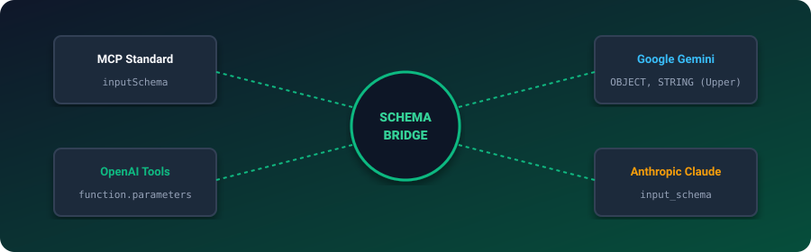
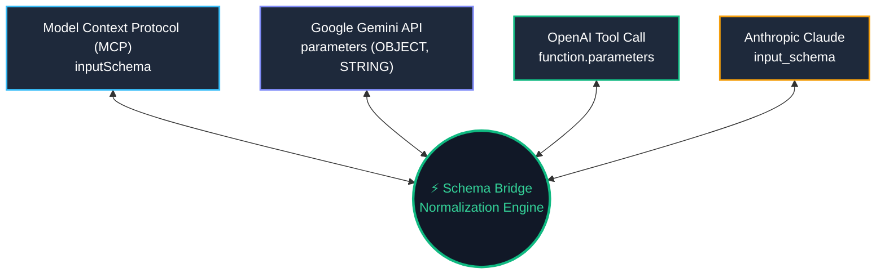

# Schema Bridge AI 🌉

<p align="center">
  
</p>

<p align="center">
  <a href="https://github.com/ejajmahmud/schema-bridge-ai/releases"></a>
  <a href="LICENSE"></a>
  <a href="https://www.python.org/"></a>
  <a href="https://modelcontextprotocol.io/"></a>
  <a href="https://github.com/ejajmahmud/schema-bridge-ai/actions"></a>
</p>

**Schema Bridge AI** is a universal, lossless tool and function declaration transpiler across modern AI ecosystems:
- **Model Context Protocol (MCP)** (`inputSchema`)
- **Google Gemini** (`parameters` with uppercase types: `STRING`, `OBJECT`, `INTEGER`, etc.)
- **OpenAI** (`type: "function"`, `parameters`)
- **Anthropic Claude** (`input_schema`)

---

## ⚡ Universal Translation Topology



---

## 📊 Type Mapping Matrix

| Abstract Type | Standard JSON / MCP | Google Gemini SDK | OpenAI Function | Anthropic Claude |
|---|---|---|---|---|
| String | `"type": "string"` | `"type": "STRING"` | `"type": "string"` | `"type": "string"` |
| Integer | `"type": "integer"` | `"type": "INTEGER"` | `"type": "integer"` | `"type": "integer"` |
| Float / Number | `"type": "number"` | `"type": "NUMBER"` | `"type": "number"` | `"type": "number"` |
| Boolean | `"type": "boolean"` | `"type": "BOOLEAN"` | `"type": "boolean"` | `"type": "boolean"` |
| Object | `"type": "object"` | `"type": "OBJECT"` | `"type": "object"` | `"type": "object"` |
| Array | `"type": "array"` | `"type": "ARRAY"` | `"type": "array"` | `"type": "array"` |

---

## 📦 Installation

```bash
git clone https://github.com/ejajmahmud/schema-bridge-ai.git
cd schema-bridge-ai
pip install -e .
```

---

## 🚀 Quickstart

### Python SDK

```python
from schema_bridge_ai import convert_tool

mcp_tool = {
    "name": "calculate_tax",
    "description": "Calculates sales tax",
    "inputSchema": {
        "type": "object",
        "properties": {
            "amount": {"type": "number"},
            "state": {"type": "string"}
        },
        "required": ["amount", "state"]
    }
}

# Convert MCP tool directly to Gemini format with uppercase type normalization
gemini_tool = convert_tool(mcp_tool, source_format="mcp", target_format="gemini")
print(gemini_tool)
```

### CLI Command

```bash
# Convert an MCP tool list to OpenAI format
schema-bridge tools_mcp.json --from mcp --to openai -o tools_openai.json

# Convert OpenAI functions to Gemini format
schema-bridge functions.json --from openai --to gemini -o gemini_tools.json
```

---

## 🧪 Running Tests

```bash
python -m unittest discover -s tests
```

---

## 📄 License

MIT © [Ejaj Mahmud](https://github.com/ejajmahmud)
